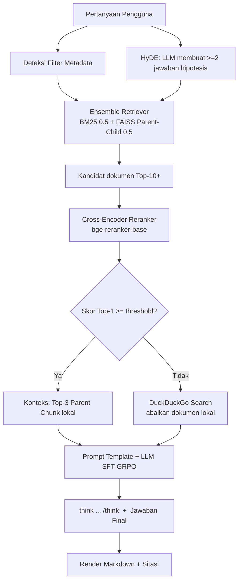
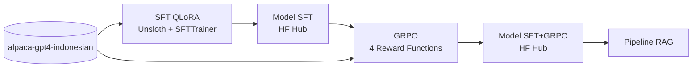

<p align="center">
  
</p>

<h1 align="center">⚖️ Legal RAG Chatbot</h1>
<h3 align="center">Chatbot Tim Legal berbasis RAG dengan LLM Hasil Fine-Tuning (SFT + GRPO) untuk Peraturan Ketenagakerjaan &amp; Perizinan Berusaha</h3>

<p align="center">
  <a href="https://huggingface.co/spaces/USERNAME_HF/legal-rag-chatbot"></a>
  <a href="https://huggingface.co/putraharifin/llama-3.2-3b-legal-id-PGABL-putraharifin25"></a>
  <a href="https://huggingface.co/putraharifin/llama-3.2-3b-legal-id-GRPO-PGABL-putraharifin25"></a>
  
  
  
  
</p>

---

## 📑 Daftar Isi

1. [Ringkasan Proyek](#-ringkasan-proyek)
2. [Latar Belakang &amp; Permasalahan](#-latar-belakang--permasalahan)
3. [Tujuan](#-tujuan)
4. [Fitur Utama](#-fitur-utama)
5. [Arsitektur Sistem](#-arsitektur-sistem)
6. [Tech Stack](#-tech-stack)
7. [Data](#-data)
8. [Tahap 1 – Supervised Fine-Tuning (SFT) dengan QLoRA](#-tahap-1--supervised-fine-tuning-sft-dengan-qlora)
9. [Tahap 2 – Reinforcement Learning dengan GRPO](#-tahap-2--reinforcement-learning-dengan-grpo)
10. [Tahap 3 – Pipeline RAG](#-tahap-3--pipeline-rag)
11. [Tahap 4 – Antarmuka &amp; Deployment](#-tahap-4--antarmuka--deployment)
12. [Hasil &amp; Evaluasi](#-hasil--evaluasi)
13. [Struktur Repositori](#-struktur-repositori)
14. [Cara Menjalankan](#-cara-menjalankan)
15. [Keterbatasan](#-keterbatasan)
16. [Rencana Pengembangan](#-rencana-pengembangan)
17. [Lisensi &amp; Disclaimer](#-lisensi--disclaimer)
18. [Kontak](#-kontak)

---

## 🎯 Ringkasan Proyek

**Legal RAG Chatbot** adalah asisten tanya-jawab hukum untuk Tim Legal yang menjawab pertanyaan berbahasa Indonesia berdasarkan empat peraturan resmi:

| No | Dokumen | Cakupan umum |
|----|---------|--------------|
| 1 | UU Nomor 6 Tahun 2023 | Penetapan Perppu Cipta Kerja menjadi undang-undang |
| 2 | PP Nomor 5 Tahun 2021 | Penyelenggaraan perizinan berusaha berbasis risiko |
| 3 | PP Nomor 35 Tahun 2021 | PKWT, alih daya, waktu kerja &amp; istirahat, PHK |
| 4 | PP Nomor 51 Tahun 2023 | Perubahan PP Pengupahan |

Sistem ini menggabungkan tiga komponen:

1. **LLM hasil fine-tuning**: Llama-3.2-3B-Instruct yang dilatih dengan **QLoRA (SFT)** pada dataset instruksi Bahasa Indonesia, lalu disempurnakan dengan **GRPO** agar menampilkan proses penalaran hukum di dalam tag `<think>…</think>` sebelum memberi jawaban final.
2. **Pipeline Retrieval-Augmented Generation (RAG) tingkat lanjut**: Parent-Child Retriever, Metadata Enrichment &amp; Filtering, Ensemble Retriever (BM25 + FAISS), HyDE, Cross-Encoder Reranker, dan fallback pencarian internet (DuckDuckGo) secara kondisional.
3. **Antarmuka web &amp; deployment** di Hugging Face Spaces, lengkap dengan sitasi otomatis (nama dokumen + nomor halaman).

<p align="center">
  
  <br><em>Gambar 1. Tampilan antarmuka chatbot (ganti dengan screenshot Anda).</em>
</p>

---

## 🧩 Latar Belakang &amp; Permasalahan

Tim legal perusahaan sering menerima pertanyaan dari karyawan maupun manajemen, misalnya *"Apakah staf admin berhak atas uang lembur?"* atau *"Berapa lama maksimal kontrak PKWT?"*. Menjawabnya secara manual menghadapi beberapa masalah:

| Masalah | Dampak |
|---------|--------|
| Dokumen hukum panjang (ratusan halaman) dan saling merujuk | Mencari pasal relevan memakan waktu |
| Bahasa hukum formal dan tersebar di beberapa peraturan | Risiko salah tafsir atau terlewat ketentuan |
| Jawaban perlu dasar hukum yang bisa ditelusuri | Dibutuhkan sitasi nama peraturan dan halaman |
| LLM umum cenderung **berhalusinasi** pada domain hukum | Jawaban bisa terdengar meyakinkan tetapi salah |
| LLM umum tidak dioptimalkan untuk Bahasa Indonesia dan format penalaran | Jawaban tidak konsisten, kadang berpindah bahasa |
| Pengetahuan LLM statis | Peraturan baru atau pertanyaan di luar dokumen tidak terjawab |

### Pertanyaan riset

> Bagaimana membangun chatbot hukum berbahasa Indonesia yang **menalar secara transparan**, **berbasis dokumen resmi dengan sitasi**, dan **tahu kapan harus mencari sumber lain**, dengan sumber daya komputasi terbatas (GPU gratis Kaggle)?

---

## 🎯 Tujuan

1. Melakukan **fine-tuning efisien (QLoRA)** pada LLM open-source dengan dataset instruksi Bahasa Indonesia.
2. Menerapkan **GRPO dengan 4 reward function kustom** agar model menulis penalaran `<think>` terstruktur, berbahasa Indonesia, dan relevan dengan jawaban referensi.
3. Membangun **pipeline RAG** yang akurat dengan retrieval hibrida, transformasi query (HyDE), reranking, serta sitasi otomatis.
4. Menyediakan **fallback internet** bila dokumen lokal tidak relevan.
5. Men-*deploy* sistem agar dapat dicoba publik.

---

## ✨ Fitur Utama

- 🧠 **Penalaran transparan**: model menampilkan proses berpikir di dalam `<think>…</think>` sebelum jawaban final.
- 📚 **Sitasi otomatis**: setiap jawaban menyertakan *nama dokumen + halaman* sumber.
- 🔎 **Retrieval hibrida**: BM25 (kata kunci) + FAISS (semantik) dengan bobot seimbang `[0.5, 0.5]`.
- 🧱 **Parent-Child Retriever**: pencarian pada potongan kecil (akurat), konteks LLM dari potongan besar (kaya).
- 🪄 **HyDE**: query diperkaya ≥ 2 jawaban hipotesis dari LLM sebelum pencarian.
- 🎯 **Cross-Encoder Reranker**: memilih Top-3 chunk paling relevan dari kandidat Ensemble.
- 🌐 **Conditional Web Search**: bila skor reranker Top-1 di bawah threshold, dokumen lokal diabaikan dan sistem beralih ke DuckDuckGo.
- 🏷️ **Metadata filtering**: kueri seperti "menurut PP 35 Tahun 2021" otomatis memfilter dokumen.
- 💬 **Antarmuka interaktif**: loop `input()` + `IPython.display.Markdown` di notebook, dan UI Gradio di Hugging Face Space.

---

## 🏗️ Arsitektur Sistem

<p align="center">
  
  <br><em>Gambar 2. Arsitektur end-to-end (ganti dengan diagram buatan Anda; diagram Mermaid di bawah dapat dipakai sebagai acuan).</em>
</p>



### Alur Pelatihan



---

## 🛠️ Tech Stack

| Kategori | Teknologi |
|----------|-----------|
| Bahasa &amp; Lingkungan | Python 3.10+, Kaggle Notebook (GPU T4 / P100) |
| Fine-tuning | Unsloth, TRL (`SFTTrainer`, `GRPOTrainer`), PEFT, bitsandbytes (4-bit NF4 + double quantization) |
| Model dasar | `unsloth/Llama-3.2-3B-Instruct` |
| Experiment tracking | Weights &amp; Biases |
| RAG | LangChain, FAISS, `rank_bm25`, PyPDF |
| Embedding | `sentence-transformers/paraphrase-multilingual-MiniLM-L12-v2` |
| Reranker | `BAAI/bge-reranker-base` (Cross-Encoder) |
| Web search | DuckDuckGo (`ddgs`) |
| UI &amp; Deployment | Gradio, Hugging Face Spaces (ZeroGPU) |
| Distribusi model | Hugging Face Hub (`merged_16bit`) |

---

## 📦 Data

### Dataset pelatihan

- **`Ichsan2895/alpaca-gpt4-indonesian`**: dataset instruksi format Alpaca (`instruction`, `input`, `output`) berbahasa Indonesia.
- Digunakan untuk **SFT** dan **GRPO** (kolom `output` menjadi *ground truth* pada `correctness_reward`).

### Korpus RAG

Empat dokumen PDF peraturan (lihat tabel di [Ringkasan Proyek](#-ringkasan-proyek)). Dokumen **tidak disertakan** di repositori ini; letakkan sendiri di folder `data/pdf/`.

### Metadata Enrichment

Setiap chunk diperkaya metadata otomatis:

| Field | Contoh | Kegunaan |
|-------|--------|----------|
| `source` | `PP Nomor 35 Tahun 2021.pdf` | Nama file asli |
| `page` | `12` | Nomor halaman (1-based) |
| `citation` | `PP Nomor 35 Tahun 2021 halaman 12` | Teks sitasi siap pakai |
| `jenis` | `PP` | Filter jenis peraturan |
| `nomor` / `tahun` | `35` / `2021` | Filter nomor &amp; tahun |
| `parent_id` | UUID | Menghubungkan Child → Parent |

---

## 🔧 Tahap 1 – Supervised Fine-Tuning (SFT) dengan QLoRA

Notebook: [`notebooks/Fine-tuning_submission_PGABL_Nama-siswa.ipynb`](notebooks/)

### 1.1 Persiapan data

1. Muat dataset dari Hugging Face dan ambil subset acak (±20.000 baris) agar training 800 step efisien.
2. **Mapping ke Chat Template Llama-3** (`system` / `user` / `assistant` dengan token spesial `<|begin_of_text|>`, `<|start_header_id|>`, `<|eot_id|>`). Kolom `input` digabung ke pesan pengguna bila ada.
3. Bagi data secara eksplisit: **`train_dataset` (99%)** dan **`eval_dataset` (1%)**, `seed=3407`.

<p align="center">
  
  <br><em>Gambar 3. Contoh satu baris dataset setelah dimapping ke chat template.</em>
</p>

### 1.2 Konfigurasi model (QLoRA)

| Parameter | Nilai |
|-----------|-------|
| Model dasar | `unsloth/Llama-3.2-3B-Instruct` |
| Kuantisasi | 4-bit NF4 + **double quantization** |
| `max_seq_length` | 1024 |
| LoRA rank / alpha / dropout | 16 / 16 / 0 |
| Target modules | `q_proj`, `k_proj`, `v_proj`, `o_proj` (Multi-Head Attention) + `gate_proj`, `up_proj`, `down_proj` (Feed Forward Network) |
| Gradient checkpointing | `"unsloth"` |

### 1.3 Konfigurasi training

| Hyperparameter | Eksperimen 1 | Eksperimen 2 |
|----------------|--------------|--------------|
| Learning rate | `2e-4` | `[isi]` |
| Max steps | 800 | 800 |
| Batch size × grad. accumulation | 2 × 8 (efektif 16) | `[isi]` |
| Scheduler / warmup | cosine / 40 | `[isi]` |
| Optimizer | `adamw_8bit` | `adamw_8bit` |
| Eval strategy | `steps` (setiap 100 step) | `steps` |
| Logging | Weights &amp; Biases | Weights &amp; Biases |
| Train loss akhir | `[isi]` | `[isi]` |
| Eval loss akhir | `[isi]` | `[isi]` |

Dua eksperimen dibandingkan lewat kurva loss di WandB untuk memilih konfigurasi terbaik **tanpa overfitting**.

<p align="center">
  
  <br><em>Gambar 4. Kurva train/eval loss SFT pada Weights &amp; Biases.</em>
</p>

### 1.4 Distribusi model

Model digabung dan diunggah ke Hugging Face Hub dengan `push_to_hub_merged(..., save_method="merged_16bit")`:
👉 [`putraharifin/llama-3.2-3b-legal-id-PGABL-putraharifin25`](https://huggingface.co/putraharifin/llama-3.2-3b-legal-id-PGABL-putraharifin25)

---

## 🏆 Tahap 2 – Reinforcement Learning dengan GRPO

Notebook: [`notebooks/GRPO_submission_PGABL_Nama-siswa.ipynb`](notebooks/)

**Motivasi:** SFT mengajarkan gaya jawaban, tetapi tidak menjamin model **menalar secara eksplisit**. GRPO (*Group Relative Policy Optimization*) memberi sinyal reward langsung sehingga model belajar format `<think>…</think>` + jawaban final berbahasa Indonesia tanpa reward model terpisah.

### 2.1 Setup

- Model awal: model SFT dari Hugging Face Hub (dimuat 4-bit, LoRA baru r=16).
- Prompt: *system prompt* yang menetapkan format `<think>…</think>` + jawaban; *ground truth* diambil dari kolom `output`.
- Dataset: `Ichsan2895/alpaca-gpt4-indonesian` (disaring: output 40–600 karakter, 1.000 prompt).
- Mitigasi OOM: `num_generations=4`, `max_completion_length=384`, `max_prompt_length=256`, batch 4 × grad. accumulation 4, `adamw_8bit`, gradient checkpointing Unsloth.
- Logging: Weights &amp; Biases, proyek `PGABL-legal-chatbot-grpo`.

### 2.2 Empat Reward Function

| Reward | Aturan | Rentang |
|--------|--------|---------|
| `format_reward_func` (*reward shaping*) | `<think>` terbuka **+0.2**; `</think>` tertutup **+0.3**; format sempurna (di awal, tertutup benar, diikuti jawaban akhir) **+1.0**; tag muncul &gt; 1 kali **−0.5** | −0.5 … 1.0 |
| `reasoning_length_reward` | Panjang isi `<think>`: kosong/tanpa tag **0.0**; &lt; 50 karakter **0.2**; 50–199 karakter **0.5**; ≥ 200 karakter **1.0**. Toleran terhadap penalaran yang terpotong batas token | 0.0 … 1.0 |
| `correctness_reward` | **+1.0** bila jawaban final (setelah `</think>`) memuat *ground truth* atau ≥ 40% kata kunci dari kolom `output` | 0.0 / 1.0 |
| `language_reward_func` | **−0.5** bila jawaban beralih ke Bahasa Inggris; **+1.0** bila murni Bahasa Indonesia | −0.5 … 1.0 |

<p align="center">
  
  <br><em>Gambar 5. Kurva reward GRPO (format, panjang penalaran, correctness, bahasa).</em>
</p>

### 2.3 Distribusi model

👉 [`putraharifin/llama-3.2-3b-legal-id-GRPO-PGABL-putraharifin25`](https://huggingface.co/putraharifin/llama-3.2-3b-legal-id-GRPO-PGABL-putraharifin25) (`merged_16bit`)

### 2.4 Uji wajib

> **Prompt:** *"Saya staf admin, kemarin lembur 3 jam untuk beresin laporan. Apakah saya berhak dapat uang lembur?"*

Model diharapkan menampilkan penalaran di `<think>…</think>` terlebih dahulu, lalu jawaban final berbahasa Indonesia.

<p align="center">
  
  <br><em>Gambar 6. Output mentah uji wajib: penalaran &lt;think&gt; diikuti jawaban final.</em>
</p>

---

## 🔍 Tahap 3 – Pipeline RAG

Notebook: [`notebooks/RAG_submission_PGABL_Nama-siswa.ipynb`](notebooks/)

### 3.1 Loading &amp; Parent-Child Splitting

1. Muat 4 PDF dengan `PyPDFLoader` per halaman, lalu terapkan **Metadata Enrichment**.
2. **Parent chunks**: `RecursiveCharacterTextSplitter(chunk_size=1000, chunk_overlap=100)`, konteks kaya untuk LLM.
3. **Child chunks**: `chunk_size=200, chunk_overlap=40`, akurat untuk pencarian vektor; mewarisi metadata dan `parent_id`.

### 3.2 Vector Database

- Embedding open-source multibahasa (`paraphrase-multilingual-MiniLM-L12-v2`), dipilih karena korpus berbahasa Indonesia.
- Child chunks disimpan di **FAISS**; **InMemoryStore** memetakan `parent_id → Parent chunk`.
- `ParentChildRetriever` kustom: cari child → ambil parent unik berurutan relevansi.

### 3.3 Ensemble Retriever

`EnsembleRetriever(BM25 + ParentChildRetriever FAISS, weights=[0.5, 0.5])` mengambil minimal **Top-5** (implementasi: Top-10 per retriever) dengan *Reciprocal Rank Fusion*.

### 3.4 HyDE (Hypothetical Document Embeddings)

1. Query dikirim ke LLM untuk membuat **≥ 2 jawaban hipotesis** (`num_return_sequences=2`, `temperature=0.8`).
2. Query asli + setiap hipotesis dijalankan ke Ensemble Retriever.
3. Hasil digabung dan di-*dedupe* sebagai kandidat reranking.

### 3.5 Cross-Encoder Reranker &amp; Conditional Web Search

1. `BAAI/bge-reranker-base` memberi skor (sigmoid 0–1) pada setiap pasangan *(query, chunk)* dan menyaring **Top-3**.
2. **Aturan kondisional:**

```python
if skor_top1 >= RERANK_THRESHOLD:     # dokumen lokal relevan
    konteks = top3_dokumen_lokal
else:                                  # abaikan dokumen lokal
    konteks = duckduckgo_search(query)
```

3. Threshold dikalibrasi dengan membandingkan skor query dalam domain (hukum ketenagakerjaan) dan di luar domain.

### 3.6 Generasi jawaban &amp; sitasi

- **Prompt Template** Bahasa Indonesia menyuntikkan `{context}` dan `{question}`, serta memerintahkan penalaran dalam `<think>…</think>`.
- Output di-*parse* menjadi tiga bagian: **Proses Penalaran**, **Jawaban**, **Sumber** (nama dokumen + halaman atau tautan web).
- Antarmuka notebook: *interactive loop* `input()` + `IPython.display.Markdown`.

<p align="center">
  
  <br><em>Gambar 7. Jawaban dari dokumen lokal lengkap dengan sitasi halaman.</em>
</p>

<p align="center">
  
  <br><em>Gambar 8. Fallback DuckDuckGo saat skor Top-1 di bawah threshold.</em>
</p>

---

## 🚀 Tahap 4 – Antarmuka &amp; Deployment

### 4.1 Pilihan platform

| Opsi | Kelebihan | Kekurangan |
|------|-----------|------------|
| **Hugging Face Space (Gradio + ZeroGPU)** ✅ dipakai | Gratis, GPU nyata saat inferensi, satu ekosistem dengan model | Kuota GPU harian per pengguna |
| Hugging Face Space (Docker + Streamlit) | UI Streamlit penuh | Memerlukan paket berbayar |
| Streamlit Community Cloud | Gratis | Hanya CPU dengan RAM terbatas, tidak cukup untuk LLM 3B |
| Kaggle/Colab + tautan Gradio sementara | Cepat untuk demo | Tidak permanen |

### 4.2 Arsitektur deployment

1. **Offline (Kaggle):** bangun indeks FAISS dan simpan `parents.json` + `faiss_index/`.
2. **Space:** `app.py` memuat indeks, model GRPO (fp16), embedding (CPU), dan reranker; satu fungsi `@spaces.GPU` menjalankan HyDE → retrieval → rerank → generasi.
3. **Sekret:** `HF_TOKEN` (opsional) disimpan di *Settings → Secrets*, tidak pernah ditulis di kode.

Langkah rinci ada di [`space/`](space/) dan bagian [Cara Menjalankan](#-cara-menjalankan).

<p align="center">
  
  <br><em>Gambar 9. Aplikasi berjalan di Hugging Face Space.</em>
</p>

---

## 📊 Hasil &amp; Evaluasi

> Isi bagian ini dengan hasil run Anda. Tabel di bawah adalah kerangka yang disarankan.

### 5.1 Training

| Tahap | Metrik | Hasil |
|-------|--------|-------|
| SFT | Train loss / Eval loss akhir | `[isi]` / `[isi]` |
| GRPO | Rata-rata total reward awal → akhir | `[isi]` → `[isi]` |
| GRPO | `format_reward_func` awal → akhir | `[isi]` → `[isi]` |
| GRPO | Penggunaan VRAM puncak | `[isi]` GB |

### 5.2 Kualitas retrieval &amp; jawaban (kualitatif)

| Pertanyaan uji | Mode | Skor Top-1 | Sitasi | Catatan |
|----------------|------|-----------|--------|---------|
| Apakah staf admin berhak uang lembur? | local | `[isi]` | `[isi]` | `[isi]` |
| Berapa maksimal PKWT menurut PP 35/2021? | local (filter metadata) | `[isi]` | `[isi]` | `[isi]` |
| Pertanyaan di luar domain (mis. resep masakan) | web | `[isi]` | tautan web | `[isi]` |

### 5.3 Contoh output

```text
<think>
Pengguna adalah staf admin (pekerja non-manajerial). Berdasarkan PP 35 Tahun 2021, pekerja yang bekerja
melebihi waktu kerja wajib dibayar upah lembur. Lembur 3 jam termasuk waktu kerja lembur ...
</think>
Ya, Anda berhak mendapatkan upah lembur ... (isi dengan output nyata Anda)

Sumber: PP Nomor 35 Tahun 2021 halaman [isi]
```

---

## 🗂️ Struktur Repositori

```text
legal-rag-chatbot/
├── README.md
├── requirements.txt
├── link_huggingface.txt
├── assets/                       # gambar dokumentasi
│   ├── banner.png
│   ├── architecture.png
│   ├── demo-ui.png
│   ├── sft-dataset-mapping.png
│   ├── sft-wandb-loss.png
│   ├── grpo-rewards.png
│   ├── grpo-inference-test.png
│   ├── rag-local-answer.png
│   ├── rag-web-fallback.png
│   └── space-deployment.png
├── notebooks/
│   ├── Fine-tuning_submission_PGABL_Nama-siswa.ipynb
│   ├── GRPO_submission_PGABL_Nama-siswa.ipynb
│   └── RAG_submission_PGABL_Nama-siswa.ipynb
├── data/
│   └── pdf/                      # 4 PDF peraturan (tidak di-commit)
└── space/                        # kode deployment Hugging Face Space
    ├── app.py
    ├── requirements.txt
    ├── README.md                 # YAML konfigurasi Space
    └── data/                     # parents.json + faiss_index/ (hasil export)
```

---

## ▶️ Cara Menjalankan

### A. Prasyarat

- Akun [Kaggle](https://www.kaggle.com) (GPU T4 ×2 / P100, Internet aktif), [Hugging Face](https://huggingface.co) (token **write**), dan [Weights &amp; Biases](https://wandb.ai).
- Tambahkan secret `HF_TOKEN` dan `WANDB_API_KEY` di Kaggle (*Add-ons → Secrets*). **Jangan** menulis token di kode.

### B. Urutan notebook

1. **SFT**: jalankan `Fine-tuning_submission_PGABL_Nama-siswa.ipynb` (6 blok) → model SFT di Hugging Face Hub.
2. **GRPO**: jalankan `GRPO_submission_PGABL_Nama-siswa.ipynb` (5 blok) → model GRPO di Hugging Face Hub.
3. **RAG**: unggah 4 PDF sebagai Kaggle Dataset, lalu jalankan `RAG_submission_PGABL_Nama-siswa.ipynb` (7 blok).

### C. Menjalankan lokal (opsional, perlu GPU)

```bash
git clone https://github.com/USERNAME_GITHUB/legal-rag-chatbot.git
cd legal-rag-chatbot
python -m venv .venv && source .venv/bin/activate
pip install -r requirements.txt
```

### D. Deploy ke Hugging Face Space

1. Ekspor indeks dari notebook RAG (setelah blok vector database):

   ```python
   import json, os
   os.makedirs("space_data", exist_ok=True)
   vectorstore.save_local("space_data/faiss_index")
   with open("space_data/parents.json", "w", encoding="utf-8") as f:
       json.dump([{"page_content": p.page_content, "metadata": p.metadata} for p in parent_docs],
                 f, ensure_ascii=False)
   ```

2. Buat Space baru di huggingface.co/new-space: SDK **Gradio**, hardware **ZeroGPU**.
3. Unggah `space/app.py`, `space/requirements.txt`, `space/README.md` ke root Space.
4. Unggah data hasil ekspor ke folder `data/` pada Space:

   ```python
   from huggingface_hub import HfApi
   api = HfApi(token="HF_TOKEN_WRITE")
   api.upload_folder(folder_path="space_data", path_in_repo="data",
                     repo_id="USERNAME_HF/legal-rag-chatbot", repo_type="space")
   ```

5. Tunggu build selesai (pengunduhan model beberapa menit), lalu uji dengan prompt wajib.

---

## ⚠️ Keterbatasan

- **Bukan nasihat hukum.** Keluaran bersifat referensi dan wajib diverifikasi oleh praktisi hukum.
- **Kualitas teks PDF**: dokumen hasil pindai/OCR dapat mengandung *noise* yang memengaruhi retrieval.
- **Model 3B** masih dapat berhalusinasi atau salah menafsirkan pasal; reranker dan sitasi mengurangi, bukan menghilangkan, risiko tersebut.
- **Correctness reward** berbasis kecocokan kata kunci terhadap jawaban referensi dataset umum (bukan dataset hukum), sehingga lebih mengukur kemiripan jawaban daripada kebenaran hukum.
- **Threshold reranker** dikalibrasi manual; perlu dikalibrasi ulang bila korpus berubah.
- **Pencarian internet** tidak menjamin sumber otoritatif.
- **ZeroGPU** memiliki kuota GPU harian per pengguna dan antrean saat ramai.
- Peraturan dapat berubah; korpus tidak otomatis diperbarui.

---

## 🗺️ Rencana Pengembangan

- [ ] Evaluasi otomatis RAG (mis. RAGAS: faithfulness, answer relevancy, context precision).
- [ ] Dataset QA hukum berlabel untuk SFT/GRPO yang lebih relevan domain.
- [ ] Memori percakapan (*multi-turn*) dan *query rewriting*.
- [ ] Ekstraksi pasal/ayat secara struktural (chunking per pasal).
- [ ] Penambahan peraturan lain dan pembaruan korpus berkala.
- [ ] Antarmuka Streamlit yang memanggil Space via `gradio_client`.
- [ ] Kuantisasi GGUF untuk deployment CPU.

---

## 📜 Lisensi &amp; Disclaimer

- Kode: MIT License (sesuaikan bila perlu).
- Model turunan Llama 3.2 tunduk pada [Llama 3.2 Community License](https://www.llama.com/llama3_2/license/).
- Dataset &amp; dokumen peraturan tunduk pada lisensi masing-masing sumber.
- Proyek ini dibuat untuk tujuan **edukasi dan portofolio**; bukan pengganti konsultasi hukum profesional.

---

## 🙏 Referensi &amp; Ucapan Terima Kasih

- [Unsloth](https://github.com/unslothai/unsloth), [TRL](https://github.com/huggingface/trl), [PEFT](https://github.com/huggingface/peft)
- [LangChain](https://github.com/langchain-ai/langchain), [FAISS](https://github.com/facebookresearch/faiss), [BGE Reranker](https://huggingface.co/BAAI/bge-reranker-base)
- Gao et al., *Precise Zero-Shot Dense Retrieval without Relevance Labels* (HyDE)
- Shao et al., *DeepSeekMath* (GRPO)
- Dataset [`Ichsan2895/alpaca-gpt4-indonesian`](https://huggingface.co/datasets/Ichsan2895/alpaca-gpt4-indonesian)

---

## 📬 Kontak

**Putra Harifin**
- GitHub: [@USERNAME_GITHUB](https://github.com/USERNAME_GITHUB)
- Hugging Face: [@putraharifin](https://huggingface.co/putraharifin)
- LinkedIn / Email: `[isi]`

<p align="center"><sub>Dibuat dengan ❤️ untuk Tim Legal · Jika proyek ini bermanfaat, beri ⭐ pada repositori.</sub></p>